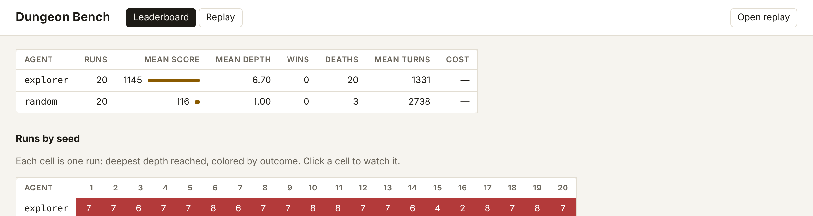
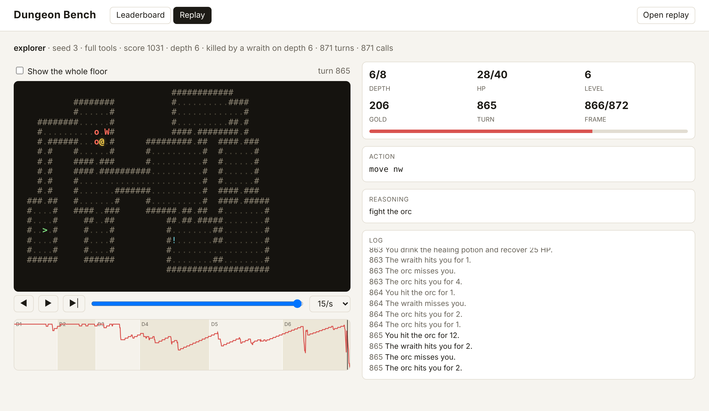

# Dungeon Bench

A small, deterministic roguelike built for AI agents to play. Agents play through tools, either over MCP or through the
Claude API. Every run is saved as a replay that you can scrub through turn by turn, with the agent's reasoning beside each
move.




Use it to compare models, prompts, effort levels, and tool designs on the exact same dungeons.

## Quick start

Requires Node 22.18 or newer. TypeScript runs directly, with no build step.

```bash
npm install
npm run play                                         # play it yourself in the terminal
npm run bench -- --agents explorer,random --seeds 1-10
npm run serve                                        # open http://localhost:8080
```

## Let Claude play

**Through Claude Code (MCP).** This repo ships a `.mcp.json`, so starting `claude` in this folder offers the
`dungeon-bench` server. Then ask: "Play a game of dungeon bench until it ends." To use it from anywhere else:

```bash
claude mcp add dungeon-bench -- node /path/to/dungeon-bench/src/cli.ts mcp --seed 1 --out /path/to/dungeon-bench/runs
```

Any MCP client works: the server speaks JSON-RPC over stdio, and replays are saved as `mcp:<client name>`.

**Through the API.** Set `ANTHROPIC_API_KEY` (or log in with `ant auth login`), then:

```bash
npm run bench -- --agents claude-haiku-5-5,claude-sonnet-5-5 --seeds 1-5 --budget 1 --concurrency 5
npm run bench -- --agents claude --model claude-opus-5-5 --effort high --seeds 1-3
```

The API agent is a manual tool-use loop. It uses adaptive thinking with summarized thoughts, which are recorded in the
replay. It also uses prompt caching, server-side compaction for long games, and server-side refusal fallbacks on models
that support them. Each run stops at `--budget` dollars or `--max-calls` tool calls. Costs are estimates from list
prices.

## The game

- Eight floors of rooms and corridors. The Heart of the Deep (`*`) waits on the last floor, guarded by a warden. Picking
  it up wins.
- Score: 100 per deepest floor reached, +1 per gold, +5 per kill, +1000 for winning.
- Bump into monsters to attack. They wake when they see you and chase you. Bats fly erratically, slimes and zombies are
  slow, and trolls regenerate.
- Items: healing potions `!`, scrolls `?` (mapping, teleport), weapons `)`, armor `[`, gold `$`.
- You regain 1 HP every 8 turns. Leveling up raises max HP and attack.
- Runs end on death, on a win, or at the turn limit (default 3000).

The game is fully deterministic. A floor depends only on the seed and its depth, so every agent faces the same maps.
Combat rolls come from a single seeded stream, so the same seed and the same actions always replay identically.

### Tools

| Tool | Toolset | What it does |
| --- | --- | --- |
| `look` | primitive | Stats, pack, the known map with coordinates, and nearby monsters and items. Takes no turn. |
| `move` | primitive | Step one of 8 directions. Moving into a monster attacks it. |
| `wait` | primitive | Pass one turn. |
| `pickup` | primitive | Pick up the item underfoot. |
| `use` | primitive | Use a pack item by slot letter (drink, read, equip). |
| `descend` | primitive | Take the stairs underfoot. |
| `travel` | full | Walk to an (x, y) square. Stops when something new appears or you take damage. |
| `explore` | full | Walk toward the nearest unexplored area, with the same stopping rules. |
| `rest` | full | Wait until healed, unless interrupted. |

Every action tool returns what happened plus the updated view, and takes an optional `note` that is shown in the replay.
Use `--toolset primitive` to test whether an agent can navigate without help.

### What an agent sees

```
Depth 1 of 8 | turn 15 | HP 20/20 | level 1 (xp 0/8) | attack 3 (fists) | defense 0 (no armor) | gold 0
Pack: empty

   000000000011111111112222222222333333333344444444
   012345678901234567890123456789012345678901234567
00             #######
01             #.....#
02   ###########.....###
03   #...................
04   #.$..######.........
05   #....#    ###.####
06   ###..#      #.#
07     #..#      #.#
08     ....      #@#
...
You are at (15,8).
Known: bat b at (15,15) 7 south, 3/3 HP, awake; chain mail [ at (7,9) 1 south, 8 west; 5 gold $ at (4,4) 4 north, 11 west.
Stairs down: not found yet.
Unexplored areas remain.
```

## Baselines

Seeds 1–20, full toolset, 3000-turn limit:

| Agent | Mean score | Mean depth | Wins | Deaths |
| --- | --- | --- | --- | --- |
| `explorer` (scripted heuristic) | 1145 | 6.70 | 0 | 20 |
| `random` | 116 | 1.00 | 0 | 3 |

The explorer clears every floor before descending, so it usually dies to trolls and wraiths on floors 6–8. An agent that
picks its fights, saves potions, and knows when to take the stairs should beat it. No agent has won yet.

## Experiments to try

- Model vs model, and effort level vs effort level, on the same seeds.
- `full` vs `primitive` tools: how much do helper tools matter?
- Prompt variants. The system prompt is `systemPrompt()` in `src/agents/claude.ts`.
- Agents over MCP (Claude Code, other clients) vs the API loop.

## Command reference

```
dungeon-bench play | bench | mcp | serve
  --seed <n> --seeds <1-10,15> --agents <list> --toolset <full|primitive>
  --max-turns <n> --max-depth <n> --model <id> --effort <level>
  --budget <dollars> --max-calls <n> --concurrency <n> --out <dir> --port <n>
```

Terminal keys: `hjkl yubn` or arrows to move, `.` wait, `g` pickup, `>` descend, `x` explore, `r` rest, `i` then a
letter to use an item, `q` quit.

## Layout

```
src/
  game.ts          rules: movement, combat, items, monster AI
  floor.ts         seeded floor generation
  grid.ts          geometry, field of view, pathfinding
  content.ts       monster and item tables
  view.ts          what agents see (text) and what replays store
  tools.ts         the tool set shared by every agent and the MCP server
  session.ts       one game plus its replay recording
  agents/          explorer, random, and the Claude API agent
  bench.ts         runs agents over seeds and summarizes
  mcp.ts           MCP server over stdio
  play.ts          terminal play
  serve.ts, cli.ts
viewer/            leaderboard and replay viewer (static, no build)
tests/
```

Replays are JSON files. Each one holds per-turn frames with the agent's view and the full truth, stored as row deltas.
`runs/index.json` lists every saved run.

## Development

```bash
npm test
npm run typecheck
```

See [TODO.md](TODO.md) for what's next.
